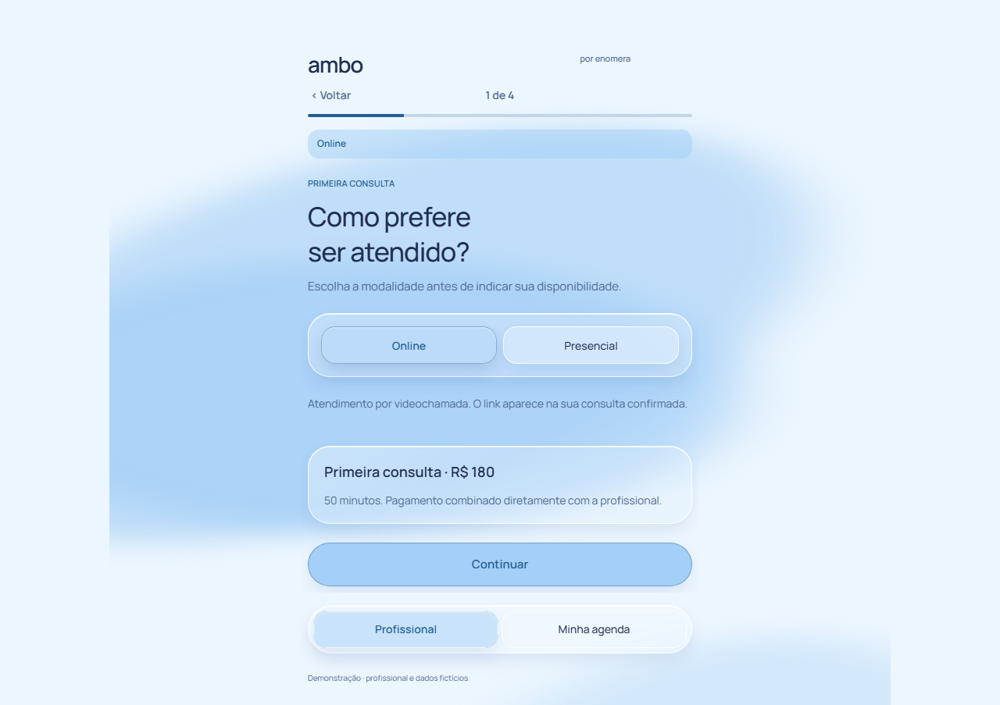
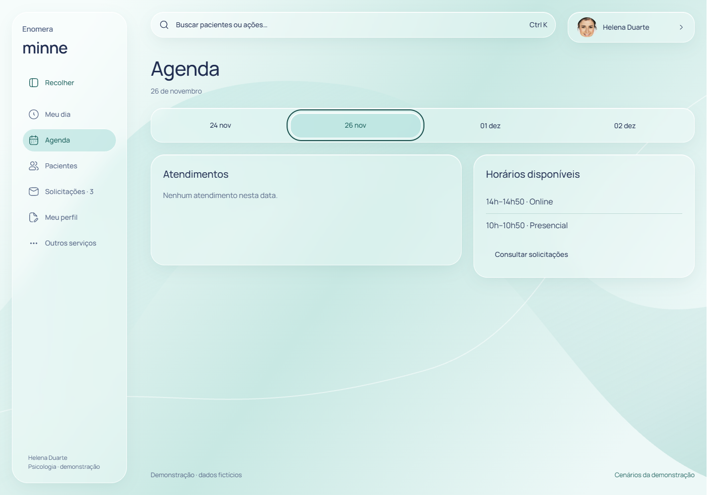

# Comparação dos produtos reais

As capturas abaixo são dos aplicativos completos; a prancha navegável `/avaliacao.html` compara as amostras incorporadas à Enomera. Celeste identifica escolha no Ambo; mineral identifica contexto no Minne. Estados confirmados permanecem verdes.

## Mobile — antes / Direção A

| Ambo anterior (402 px) | Ambo Direção A (390 px) |
|---|---|
|  |  |

| Minne anterior (390 px) | Minne Direção A (390 px) |
|---|---|
|  |  |

## Desktop — Direção A sob Liquid Glass

| Ambo (1280 px) | Minne (1440 px) |
|---|---|
|  |  |

As larguras originais estão indicadas para não sugerir equivalência de enquadramento. Capturas estáticas mostram material e cor; as gravações e os previews são a evidência de ritmo e reversão. A ocultação de marcas está disponível somente na prancha de avaliação das amostras, sem alterar os aplicativos.
